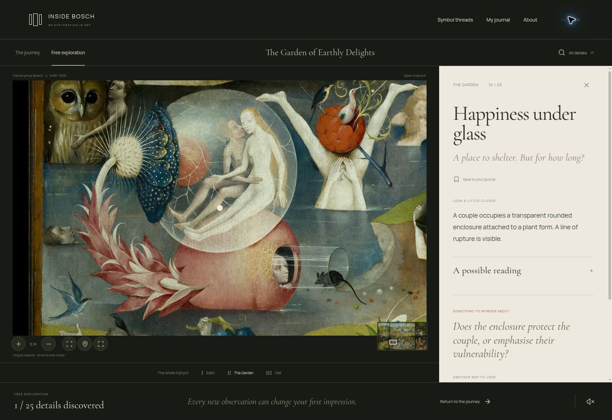

# Inside Bosch · The Garden of Secrets

**An interactive art experience by Albina Urubkina.**

One painting. Thousands of details. No simple answer. A bilingual exploration of Hieronymus Bosch’s _Garden of Earthly Delights_, built around close looking, curiosity and the visitor’s own questions.

**[Explore the live experience →](https://alyalbina.github.io/inside-bosch/)** · **[View the designed case →](https://alyalbina.github.io/inside-bosch/portfolio/index.en.html)**

**[Read the design case →](docs/portfolio/CASE_STUDY.md)** · **[Кейс на русском →](docs/portfolio/CASE_STUDY.ru.md)** · [Run locally](#run-locally) · [Design system](docs/DESIGN_SYSTEM.md)

| Project                         | My role                                                                  | Delivery                                            |
| :------------------------------ | :----------------------------------------------------------------------- | :-------------------------------------------------- |
| Self-initiated cultural product | Concept, product direction, experience requirements and visual direction | Working RU/EN prototype, AI-assisted implementation |

## From seeing to noticing

A reproduction can show the whole painting and still conceal almost everything worth discovering. Inside Bosch helps a visitor move from an intriguing detail to its context, possible readings and a question of their own.

The product keeps three things distinct: **what is visible**, **how a source interprets it**, and **what remains open**. Looking comes before explanation.



_Actual desktop screenshot of the published English prototype. The cover and visual-system plates are editorial presentation assets._

## The experience

| Entry                   | What the visitor can do                                                                                   |
| :---------------------- | :-------------------------------------------------------------------------------------------------------- |
| **A guided journey**    | Enter through the real exterior panels, follow 15 stops across three chapters, return to a saved position |
| **An open exploration** | Pan and zoom the native-resolution painting, find 25 annotated regions, search the catalogue              |
| **Five symbol threads** | Follow recurring forms across panels through explicitly labelled comparisons                              |
| **A personal journal**  | Save details, write notes and export discoveries without creating an account                              |

Russian and English cover the interface, observations, questions and source labels. Optional contemporary ambience starts only on request.

## Design decisions

**An art catalogue at the entrance.** Warm paper, a generous serif title and one authentic crop create an invitation to look. Three chapter entries offer a choice without requiring the visitor to learn a dashboard.

**A dark room around the painting.** The work becomes the primary surface. Overview markers start hidden; the selected detail stays indicated. A quiet paper reading panel holds the explanation without repeating the image.

**Interpretation on request.** Observation is visible first. A possible reading, its source and the open question follow. This hierarchy makes scholarly uncertainty part of the experience.


The artwork is never recoloured or reconstructed. Latin and Cyrillic fonts are bundled locally. See the [design system](docs/DESIGN_SYSTEM.md) and [interaction specification](docs/INTERACTION_SPECIFICATIONS.md).

## My contribution

I originated the concept, defined the product and editorial requirements, structured the discovery routes and directed the visual iterations. Frontend implementation and initial editorial drafts were developed with AI assistance.

This case shows the resulting product decisions and implementation. User interviews, measured outcome improvements and independent curator approval have not yet been completed.

→ [Full case study](docs/portfolio/CASE_STUDY.md) · [Short portfolio description](docs/portfolio/PITCH.md) · [Original MVP audit](docs/AUDIT.md)

## Built for close looking

The original interior reproduction is **39,137 × 22,279 pixels**. OpenSeadragon loads visible WebP tiles from a local 17-level Deep Zoom pyramid, rather than decoding the entire master in the browser. All 4,559 tiles are included.

| Layer           | Choice                               | Reason                                                     |
| :-------------- | :----------------------------------- | :--------------------------------------------------------- |
| Interface       | React · TypeScript · Vite            | Typed content, reusable components, static deployment      |
| Artwork         | OpenSeadragon · local DZI/WebP       | Deep zoom independent of a live third-party tile service   |
| Editorial model | Bilingual, source-linked records     | Separate observation, reading, uncertainty and coordinates |
| Journal         | Browser local storage · JSON export  | A short cultural visit without signup                      |
| Hosting         | Static build · GitHub Pages workflow | No application backend or runtime API credentials          |

The tile pyramid adds about 215 MB to the checkout. Only visible tiles are requested during exploration. [Architecture and trade-offs →](docs/TECHNICAL_ARCHITECTURE.md)

## Run locally

Use Node.js 22 or newer:

```sh
npm ci
npm run dev
```

Open the address printed by Vite. The editorial portfolio case is available at **`/portfolio/index.html`**; its English version is **`/portfolio/index.en.html`**.

```sh
npm test
npm run build
```

After building, `node scripts/serve.mjs` serves the project at `http://localhost:4173`. The downloadable archive also includes a compiled interface; Windows users can run `START_WINDOWS.bat`. Source `index.html` needs an HTTP server.

## Verification & next questions

Ten automated checks cover bilingual content, source and relationship IDs, region geometry, journey bounds, journal recovery, tile completeness and RU/EN opening rendering. TypeScript and the production build pass.

Desktop smoke checks verify detail entry, zoom, language switching, reading disclosure, saving/removing a detail and journal dismissal with Escape. Cross-device interactions, mobile gestures, accessibility conformance and user outcomes remain to be validated. Some annotated regions are observations without a sourced interpretation. Source provenance and claim support are documented; independent scholarly review is pending.

Next: observe first-time visitors discovering a detail, comparing a motif and returning to the whole painting. Evaluate orientation and understanding of the distinction between observation and interpretation. [Verification log →](docs/TEST_PLAN.md)

## Project map

| Location                                | Contents                                                        |
| :-------------------------------------- | :-------------------------------------------------------------- |
| [`src/components/`](src/components)     | Opening, header, viewer, reader and dialogs                     |
| [`src/data/`](src/data)                 | Bilingual details, chapters, threads and sources                |
| [`public/art/`](public/art)             | Authentic crops and the full Deep Zoom pyramid                  |
| [`public/portfolio/`](public/portfolio) | Designed case page in Russian and English                       |
| [`docs/portfolio/`](docs/portfolio)     | Repository case studies, visual plates and portfolio copy       |
| [`docs/`](docs)                         | Requirements, content model, decisions, rights and verification |
| [`tests/`](tests)                       | Content, state, asset and render checks                         |

## Publication

Source repository: **[alyalbina/inside-bosch](https://github.com/alyalbina/inside-bosch)**. See [deployment and updates](docs/PUBLISHING.md). The application and both designed case pages are deployed on GitHub Pages. [Live experience](https://alyalbina.github.io/inside-bosch/) · [Case in English](https://alyalbina.github.io/inside-bosch/portfolio/index.en.html) · [Кейс на русском](https://alyalbina.github.io/inside-bosch/portfolio/index.html).

## Artwork & credits

_The Garden of Earthly Delights_ — Hieronymus Bosch, Museo del Prado. Authentic interior and exterior reproductions are derived from the identified Wikimedia Commons public-domain records. The visual plates in this repository use the same credited images.

Code and original project writing: **MIT · Albina Urubkina**. Artwork, fonts and dependencies retain their respective rights and licences. [Provenance and sources](docs/SOURCES_AND_RIGHTS.md) · [Third-party notices](THIRD_PARTY_NOTICES.md)

Independent project, not affiliated with Museo del Prado. No analytics, signup, backend or runtime AI API.
