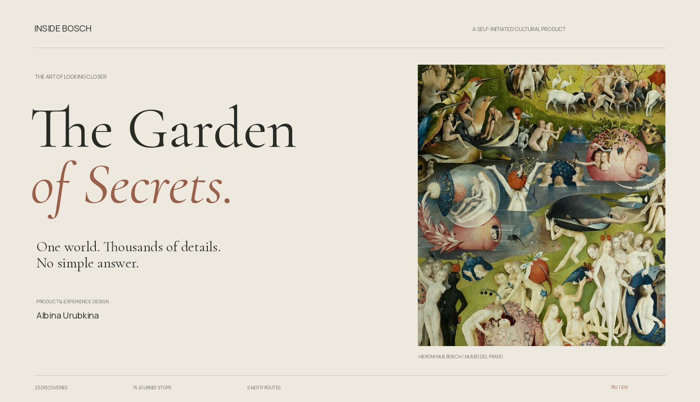
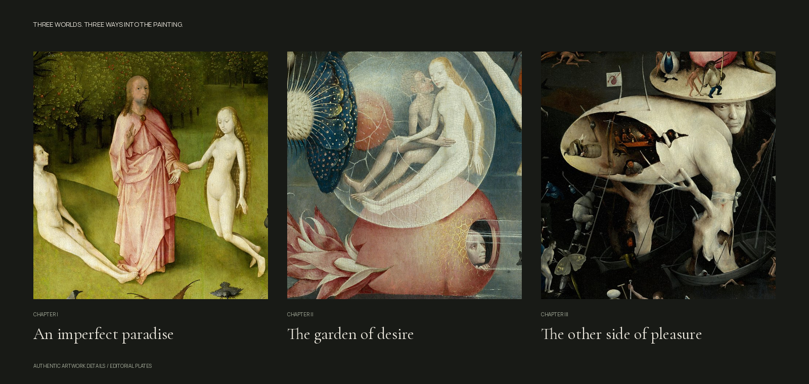
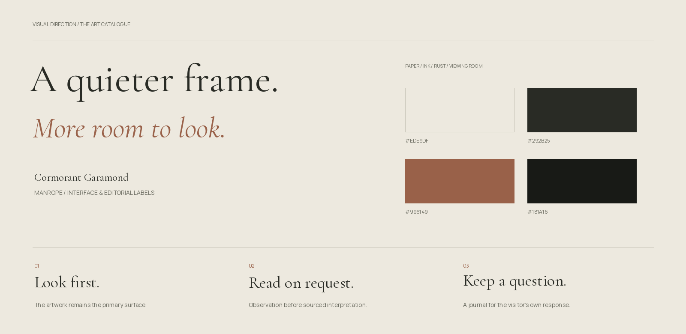

# Turning a painting into a journey of attention

**Inside Bosch · Product & experience design · Albina Urubkina**

[Русская версия](CASE_STUDY.ru.md) · [Repository overview](../../README.md) · [Portfolio summary](PITCH.md)

| Context                         | Responsibility                                                          | Result                                                      |
| :------------------------------ | :---------------------------------------------------------------------- | :---------------------------------------------------------- |
| Self-initiated cultural product | Concept, scope, experience and editorial requirements, visual direction | Working bilingual prototype with AI-assisted implementation |

## 01 — The design question

How do you help someone look closely at a painting that contains hundreds of possible stories, without replacing curiosity with a wall of explanation?

Bosch’s _Garden of Earthly Delights_ is a useful challenge: the overall image is overwhelming, the details are compelling, and many interpretations remain disputed. The product must connect a detail with its context while keeping seeing and interpreting distinct.

The intended visitors are curious first-time viewers, art enthusiasts and independent explorers. These are product hypotheses, not research-validated personas. Initial work used the artwork, source material and interface critique; visitor interviews remain a next step.

## 02 — My role

I originated the concept, defined the product and editorial requirements, structured the discovery routes and directed the visual iterations. My feedback pushed the interface toward an art catalogue: clearer hierarchy, less competing chrome and more space for the painting.

Frontend code and initial editorial drafts were developed with AI assistance. This case presents my contribution as product and experience direction; it does not claim that I hand-coded or independently curated the whole project.

## 03 — Structure without a compulsory path

A 15-stop journey provides a first entry for someone who wants guidance. Free exploration lets someone pan, zoom, search or enter through any chapter. Five motif routes connect recurring forms across the triptych.

| Visitor’s moment                   | Product response                              | Design intent                     |
| :--------------------------------- | :-------------------------------------------- | :-------------------------------- |
| “Where should I begin?”            | Primary journey action; three chapter entries | Make a first step easy            |
| “What am I seeing?”                | Detail framing and concise observation        | Return attention to the image     |
| “What could it mean?”              | Optional reading, source and claim label      | Keep interpretation attributable  |
| “Have I seen this form elsewhere?” | Related scenes and motif comparisons          | Turn recognition into exploration |
| “I want to keep this thought.”     | Saved details, notes and export               | Preserve the visitor’s questions  |

The route can be resumed and the visitor can switch modes. The journal stays in the browser without an account.

_Editorial plates from the authentic reproduction, not interface screenshots._

## 04 — From interface chrome to an art catalogue

The feature foundation existed before the visual revision. Critique exposed too many containers, persistent markers and repeated images competing with the work.

The revised opening uses warm paper, Cormorant Garamond, Manrope and a portrait crop. One main action establishes the next step; quiet chapter rows provide an alternative entry. The viewer moves to a dark surrounding space. Overview markers start hidden; the selected detail stays indicated. Reading sits on a paper-coloured panel without a duplicate image.

| Principle                            | Implemented choice                                              |
| :----------------------------------- | :-------------------------------------------------------------- |
| The work carries the atmosphere      | Authentic fragments, no recolouring or generated reconstruction |
| Typography carries hierarchy         | Expressive serif titles; quiet sans-serif controls              |
| Explanation follows attention        | Observation first; reading and sources on request               |
| Orientation stays lightweight        | Selected marker, chapter labels and return to overview          |
| Comparison avoids a universal “code” | Motif routes presented as comparisons, not definitive decoding  |

[Design system](../DESIGN_SYSTEM.md) · [Experience](../EXPERIENCE_DESIGN.md) · [Interactions](../INTERACTION_SPECIFICATIONS.md)

## 05 — Uncertainty is a content-design requirement

Each detail separates visible observation, possible readings, source IDs and an open question. Claim kinds distinguish museum interpretation, scholarly argument and visual comparison. Some details remain observation-only.

The product should not sound more certain than its evidence. A visitor can compare and retain a question without being tested on one supposedly correct meaning.

[Editorial guidelines](../EDITORIAL_GUIDELINES.md) · [Content model](../CONTENT_MODEL.md) · [Sources](../SOURCES_AND_RIGHTS.md)

## 06 — Engineering in service of looking

The master is 39,137 × 22,279 pixels. A 17-level Deep Zoom pyramid lets OpenSeadragon request visible tiles rather than decode the entire master. The complete set of 4,559 WebP tiles is included.

Local tiles remove dependence on a live third-party image endpoint. The trade-off is roughly 215 MB of tile data. React and TypeScript separate the viewer from bilingual editorial records. The static app requires no application server or runtime AI API.

## 07 — Delivered and verified

| Delivered           | Scope                                                                      |
| :------------------ | :------------------------------------------------------------------------- |
| Artwork exploration | Deep zoom, 25 annotated regions and searchable catalogue                   |
| Guided experience   | 15 stops, three chapters, exterior prologue and epilogue                   |
| Connections         | Five motif routes and related scenes                                       |
| Personal reflection | Saved details, notes, progress and JSON export                             |
| Language            | Russian and English across UI and content                                  |
| Handoff             | Source, provenance, licences, design documentation, CI and Pages workflows |

Ten automated checks and the production build pass. Checks cover content and IDs, geometry, journey boundaries, journal recovery, all tile paths and RU/EN opening rendering. The master checksum and source-image crops were checked.

Browser interaction, mobile gestures, low-memory performance, accessibility conformance, user outcomes and independent scholarly review remain pending. The visual plates here are project presentation assets, not screenshots of a browser-tested interface.

## 08 — What I would test next

Observe 8–12 first-time visitors entering a chapter, discovering a detail, following a motif and returning to overview. Ask them to distinguish observations from interpretations. Record task completion, hesitation, lost orientation and voluntary further exploration.

The key question is whether the experience produces more attentive looking while keeping visitors oriented. It remains a hypothesis; no engagement uplift or usability score is claimed.

## Reflection

The central design move was to reduce competition around the painting and make the information order deliberate. Artwork invites a question; observation focuses attention; a sourced reading opens possibilities; the journal preserves a personal response. That sequence connects visual direction, interaction and editorial responsibility.
